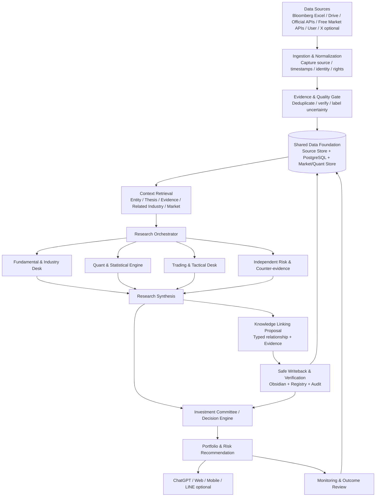
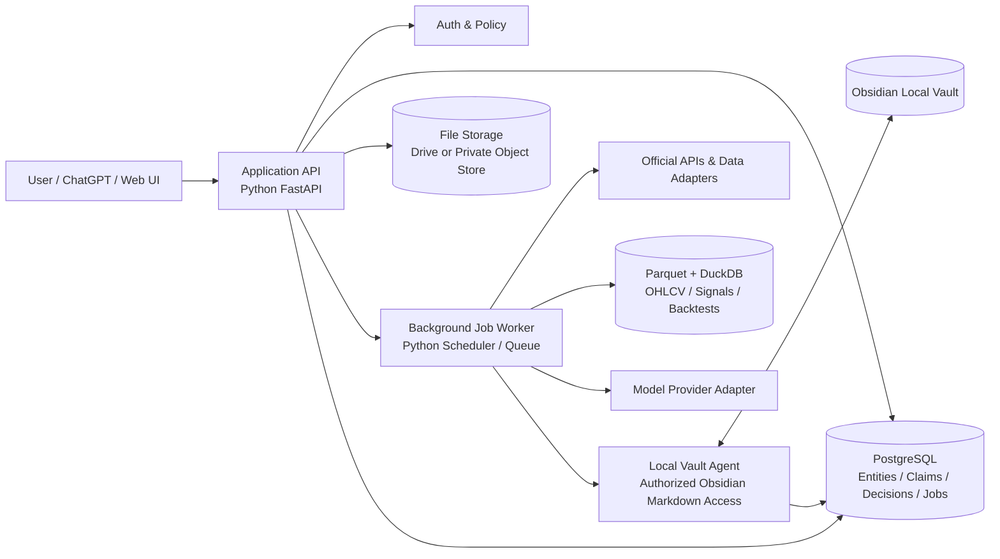
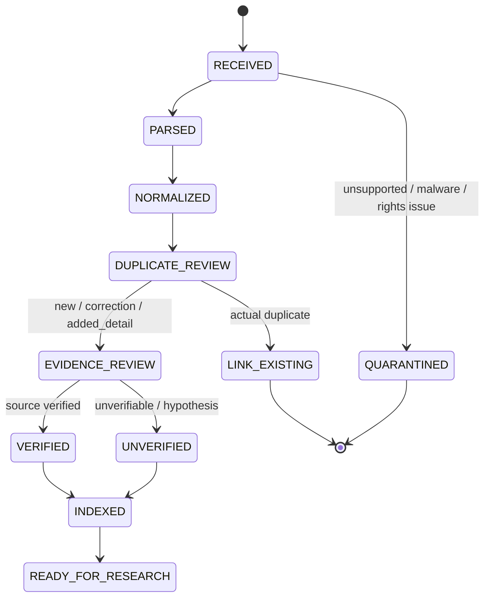
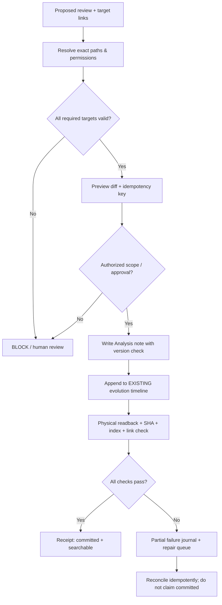
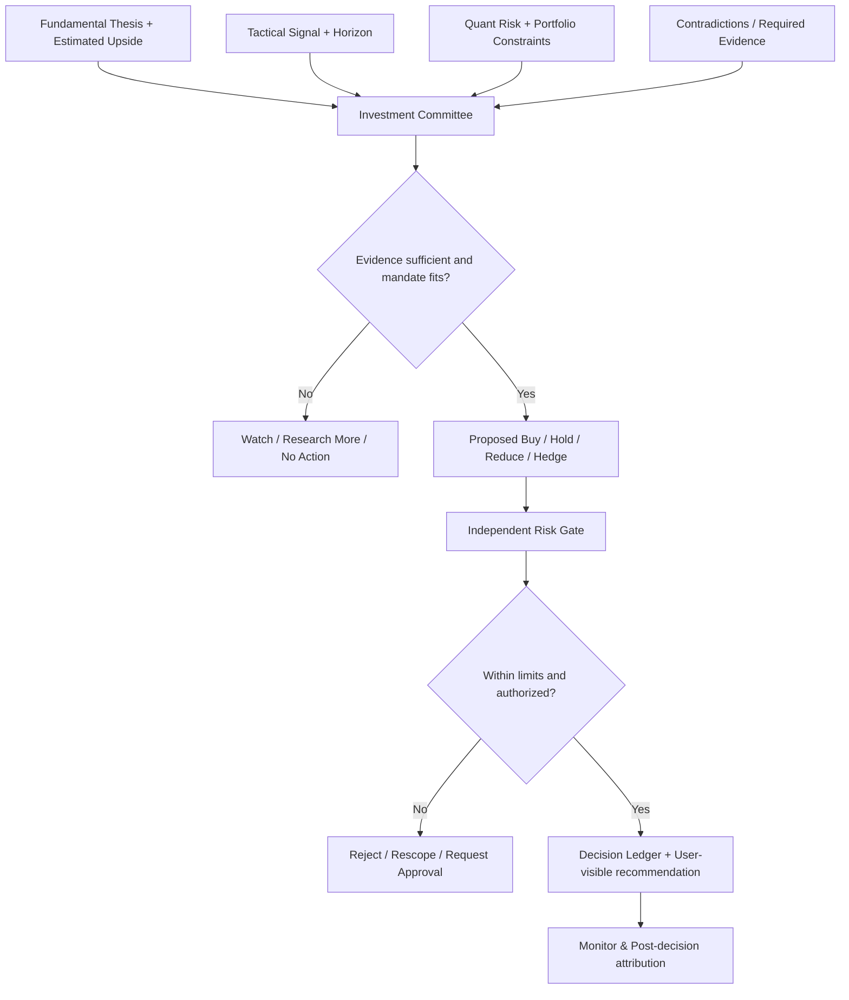

# INVESTMENT OPERATING SYSTEM
## GREENFIELD MASTER BLUEPRINT — v1.0
### Product Vision · Research Organization · Knowledge Graph · Quant · Trading · Portfolio · Data Architecture · Implementation Roadmap

> **เอกสารต้นฉบับสำหรับสร้างระบบจากศูนย์** — ไม่สมมติว่ามี Obsidian Vault, GitHub Repository, Database, Connector, PR, Agent หรือโค้ดใดติดตั้งอยู่แล้ว ข้อความ “แนะนำ” คือข้อเสนอเชิงออกแบบ ไม่ใช่สถานะที่ทำสำเร็จแล้ว
>
> **หลักคิด:** สร้างระบบที่เปลี่ยน Data → Evidence → Insight → Investment Thesis → Decision → Outcome → Learning โดยทุกขั้นตอนตรวจสอบย้อนหลังได้ และความสามารถเสริมสามารถเพิ่มทีหลังโดยไม่ต้องรื้อแกนกลาง

**Document status:** Greenfield Proposal / Design Baseline  
**วันที่จัดทำ:** 22 ตุลาคม 2026 (Asia/Bangkok)  
**ขอบเขต:** Multi-Asset Institutional Research + Fundamental/Industry/Quant/Trading + Knowledge Graph + Portfolio Intelligence  
**ช่องทางหลัก:** ChatGPT หรือ AI Frontend ที่ผู้ใช้เลือก; Web / Mobile / LINE เป็น Optional  
**ข้อจำกัดเชิงผลิตภัณฑ์:** แยก Research Recommendation จาก Trade Execution; ไม่มีการส่งคำสั่งซื้อขายอัตโนมัติเป็นค่าเริ่มต้น

---

# 00. Executive Summary — ระบบนี้คืออะไร

**Investment OS คือ AI-assisted Investment Intelligence Platform** ที่ใช้ข้อมูลจากเอกสารต้นฉบับ ตลาด การวิจัย ข่าว และมุมมองนักลงทุน ผสานกับ Historical Knowledge และเครื่องมือเชิงปริมาณ เพื่อสร้างข้อเสนอการลงทุนอย่างมีหลักฐาน กรอบเวลา และความเสี่ยงที่อธิบายได้

องค์ประกอบที่ต้องมีครบเมื่อเป็นระบบเป้าหมาย:

1. **Unified Ingestion:** รับไฟล์ Excel/CSV/PDF, ข้อความ, URL, Official APIs, Market APIs และช่องทางเสริม เช่น X
2. **Evidence & Data Governance:** แยก Fact, Claim, Quote, Source, Analyst View, AI Hypothesis, User Opinion และตรวจวันที่/License/การซ้ำ
3. **Persistent Knowledge:** Obsidian Markdown สำหรับความรู้เชิงความหมาย + Structured Database สำหรับ Entity, Graph, Audit, Portfolio + Time Series สำหรับ Market/Quant
4. **Research Intelligence:** AI Orchestrator เรียก Specialist Framework ตามโจทย์ (Fundamental, Macro, Industry, Supply Chain, Pharma, Quant, Risk ฯลฯ)
5. **Evidence-backed Knowledge Graph:** ความสัมพันธ์ต้องมี *ชนิดของความสัมพันธ์ + เหตุผล + แหล่งอ้างอิง + Validity + Verification* ไม่ใช่เชื่อมเพราะชื่อหุ้นปรากฏ
6. **Research / Trading Separation:** Research Desk ตอบ What/Why/Value; Trading Desk ตอบ Timing/Setup/Execution Risk; Independent Risk ตรวจทั้งสอง
7. **Decision Engine:** แปลง Research + Quant + Tactical + Constraints → Candidate / Watch / Buy / Hold / Reduce / Avoid / Hedge Proposal
8. **Monitoring & Learning:** ติดตาม Events, Estimates, Market Regime, Signals, Thesis Invalidation และวัด Forecast/Decision Outcome แบบไม่หลอกตนเอง
9. **Interfaces:** One Core Backend; ChatGPT/Web/Mobile/LINE เป็น Client ไม่ใช่คนละฐานความรู้
10. **Security & Real-world Feasibility:** ทุก Tool มี implementation path จริง, สิทธิ์ชัดเจน, ราคาหรือ license ตรวจสอบได้ และไม่สมมติว่า Cloud อ่าน Obsidian บนเครื่องได้โดยอัตโนมัติ

## Non-goals ในช่วงเริ่มต้น
- ไม่สร้าง Multi-Agent จำนวนมากเพียงเพื่อให้ดูเป็น “ทีม”
- ไม่ทำ HFT/Low-latency Execution จากฟรี API
- ไม่ซื้อ Bloomberg API โดยไม่มีความจำเป็น (ใช้ Manual Excel/CSV Export ได้)
- ไม่ย้าย Raw Tick/OHLCV จำนวนมหาศาลเข้า Obsidian
- ไม่ใช้ Wikilink เป็นหลักฐานว่าความสัมพันธ์ทางเศรษฐกิจถูกต้อง
- ไม่แก้ Current Thesis หรือ Portfolio Holdings อัตโนมัติโดยไม่มี Policy/Approval
- ไม่อ้างว่าผล Backtest สมจริง หากไม่รวม Fees, Slippage, Corporate Actions, Survivorship/Look-ahead Bias

---

# 01. Product Principles — กฎที่ห้ามเสีย

| ID | Principle | บังคับใช้ในระบบ |
|---|---|---|
| P-01 | Evidence before narrative | ทุก Claim สำคัญมี Source หรือสถานะ “Unverified” |
| P-02 | One logical truth, multiple stores | เก็บข้อมูลตามลักษณะงาน แต่เชื่อมด้วย Canonical IDs |
| P-03 | Analysis ≠ Fact | AI Review ไม่ใช่ Independent Evidence ของข่าวเดิม |
| P-04 | Physical persistence, not verbal success | บันทึกสำเร็จเมื่ออ่านกลับ Byte/Hash/Index/Links ได้ |
| P-05 | Distinguish time dimensions | Event, Publication, Received, Imported, Verified, As-of, Effective Date แยกกัน |
| P-06 | Relationship semantics matter | Type/Evidence/Direction/Confidence/Validity ไม่ใช่แค่ Wikilink |
| P-07 | Decision is mandate-specific | Core Investment, Tactical Trade, Hedge แยกขอบเขตและ Risk Budget |
| P-08 | No forced consensus | Specialist เห็นต่างได้; Committee ต้องสรุปข้อขัดแย้ง |
| P-09 | No fake precision | ไม่มี Market Price/Consensus ห้ามสรุป Price-in หรือ Margin of Safety เชิงตัวเลข |
| P-10 | Least privilege and reversibility | Scope, Preview, Approval, Version, Audit, Restore |
| P-11 | Reproducible quant | ทุกผลมี Data Version, Code/Model Version, Parameter, Run ID |
| P-12 | Modular evolution | เริ่ม Monolith ที่ออกแบบดี ก่อนแยกเป็น Microservices เมื่อจำเป็น |

---

# 02. End-to-End System Architecture

## 02.1 Enterprise flow — แผนภาพหลัก



> Mermaid เป็นแผนภาพที่อ่าน/แก้ได้ใน Markdown และ Obsidian; หากนำไปแสดงในระบบที่ไม่รองรับ Mermaid ให้ render diagram เป็น PNG/SVG จาก source เดียวกัน

## 02.2 Deployment / Storage architecture — เริ่มทำได้จริง



**ตัวเลือกเริ่มต้นที่ใช้งานได้จริง:** Python + FastAPI + PostgreSQL + Python Worker + Obsidian (local Markdown) + Google Drive (Raw Inbox) + DuckDB/Parquet + Git private repository สำหรับโค้ด + Backup แยกต่างหาก

**MVP Local-first:** Backend/Worker/Vault Agent อยู่บนเครื่องเดียวกับ Obsidian Vault เพื่อไม่ต้องแก้ปัญหาการเข้าถึงไฟล์ระยะไกลก่อนเวลา  
**Cloud extension:** ย้าย API/Worker/Database ขึ้น Cloud แต่ต้องมี **authorized local sync/agent** หรือ Vault replica ที่เจ้าของอนุญาต; Cloud ไม่สามารถเข้าถึง local folder โดยอาศัยคำสั่งใน Prompt เพียงอย่างเดียว

## 02.3 Two feedback loops

- **Knowledge loop:** Event → Historical Retrieval → New Analysis → Evidence-backed Links → Save → Readback → Next Event
- **Decision loop:** Research → Tactical/Quant/Risk → Decision → Portfolio/Trade Journal → Outcome → Attribution → Review → Model/Thesis Update

สองวงจรต้องเชื่อมกันแต่ห้ามสับสน: การวิเคราะห์ที่ดีไม่ได้รับประกันจังหวะซื้อขาย และการเทรดกำไรไม่ได้พิสูจน์ว่าข้อเท็จจริงทางธุรกิจถูกต้อง

---

# 03. Capability Map / Responsibility Matrix

| Capability | Input | Core processing | Output | Primary storage | Phase |
|---|---|---|---|---|---|
| Document ingestion | PDF/Excel/URL | Parse + checksum + provenance | Source record | Drive/Object + Postgres | MVP |
| Market ingestion | OHLCV/FX/Macro | Adapter + reconciliation | Standardized bars/series | Parquet/DB | MVP+ |
| Evidence Registry | Claims/citations | Identity, verification, dedup | Claim status | Postgres | MVP |
| Historical retrieval | Entity/Question | Metadata + FTS + links | Context pack | PG + Obsidian | MVP |
| AI Research | Context pack | Specialist selection + structured reasoning | Review draft | Obsidian + PG | MVP |
| Knowledge Graph | Analyst proposals | Resolve paths + semantic review | Typed edges & Wikilinks | PG + Obsidian | MVP |
| Safe Writeback | Approved plan | CAS/version + journal + readback | Persisted notes/receipts | Vault + PG | MVP |
| Quant analytics | Market/financial series | Factors/backtests/validation | Versioned signals | Parquet/PG | P1 |
| Trading & Tactical | Signal/event/price | Strategy framework + timing | Trade setup | PG | P2 |
| Portfolio & Risk | Holdings/risk/return | Exposure/constraint check | Proposal, not order | PG | P2 |
| Decision Committee | Research & risk packs | Conflict/alternatives synthesis | Decision record | PG + Obsidian | P2 |
| Monitoring | Watchlist/conditions | Job & alert rules | Alerts & review queue | PG | P3 |
| Web/LINE | Authenticated API | UI & message delivery | Dashboards/notifications | No separate truth | Optional |

---

# 04. Tools & Vendors — Real-world Implementation Matrix

**สถานะทั้งหมดในตารางนี้คือ “เครื่องมือที่เสนอสำหรับติดตั้ง/เชื่อมใน Greenfield” ไม่ใช่การยืนยันว่าเชื่อมกับบัญชีของผู้ใช้แล้ว** คำว่า Free เป็นเพียง *ผลิตภัณฑ์/API ที่มีทางเลือกไม่เสียค่าใช้จ่ายบางระดับ* ไม่ได้หมายความว่าใช้ทุกตลาด ทุกความถี่ หรือ redistribute ได้เสรี

| Tool / Service | Role | Integration method | Cost / License / Reality | Recommendation |
|---|---|---|---|---|
| **Obsidian** | Human-readable knowledge memory | Local Markdown folder; controlled filesystem agent | แอปใช้งานได้จริง; Sync ทางเลือกมีต้นทุน/ข้อจำกัด | Core |
| **Google Drive** | Raw research & Bloomberg-export inbox | Drive API v3 / OAuth; manual upload first | OAuth scope, quota, file permissions | Core |
| **Excel / CSV** | Bloomberg and broker imports | Python `openpyxl`/`pandas`/`pyarrow` | Excel export ทำได้; สิทธิ์ Bloomberg data ยังต้องตรวจ | Core |
| **Bloomberg Terminal Export** | Consensus/estimates/prices snapshot | ผู้ใช้ export แล้ว import ผ่าน controlled inbox | **No direct API assumed**; license/redistribution | Core if user has access |
| **SEC EDGAR** | US filings & XBRL fundamentals | Public `data.sec.gov` endpoints | No API key for stated endpoints; SEC automated-access policy applies | Core |
| **Company IR** | Releases, slides, transcripts | Approved URLs/manual upload; per-site APIs if any | Respect copyright/robots/use rights | Core |
| **FRED / ALFRED** | Macro/history & vintage data | Official REST API + registered key | Availability and allowed usage per terms | Core for Macro |
| **Frankfurter** | Daily FX reference rates | Public HTTPS API, no key | Daily reference; **not intraday executable FX** | Core for daily FX |
| **Alpha Vantage** | Prototype equity OHLCV | Official API, key | Free offerings have endpoint/rate/history limits; confirm coverage before production | Pilot candidate |
| **Yahoo Finance / yfinance** | Research fallback OHLCV | Python unofficial library | **Unofficial/personal-use restrictions, fragility; not primary production feed** | Optional prototype only |
| **X (formerly Twitter)** | Early signals / analyst posts | Manual link share first; official X API later | API usage may cost; repost ≠ confirmation | Optional |
| **PostgreSQL** | Canonical entities, claims, graph, audit, portfolio | SQL database | Open-source; managed hosting/backup costs | Core |
| **Parquet + DuckDB** | Quant/price analytics, backtests | Python + SQL, Parquet files | Open source; local/Cloud file storage costs | Core for Quant |
| **Private Object Storage** | Immutable PDF/Source snapshots/exports | S3-compatible or local controlled files | Provider/storage/egress charges may apply | Core once cloud |
| **Python / FastAPI** | Backend/API/adapters/research orchestrator | Python code | Open source; infra and model costs | Core |
| **GitHub (Private Repo)** | Code/CI/ADR/versioning | Git + Actions | Plan limits/secrets management | Core |
| **Railway / equivalent** | Optional cloud API/worker | Docker deployment | Usage-based hosting; do not expose Vault unintentionally | Optional hosting |
| **Vercel / Next.js** | Web dashboard | HTTPS API client | Separate auth; hosting plan constraints | Optional UI |
| **LINE Messaging API** | Notifications, chat interface | Official webhook & messaging API | Account/channel limits + pricing + signature verification | Optional |
| **LLM Provider API / ChatGPT** | Reasoning + structured output | Provider adapter with consent/cost policy | Token usage, data terms, model drift | Core capability; provider swappable |
| **Obsidian Sync** | Multi-device local vault synchronization | Official Obsidian Sync | Subscription optional; server receipt ≠ phone sync | Optional |

**Vendor selection checklist (ต้องผ่านก่อน Connect):** official docs, data licensing, country/exchange coverage, historical adjustments, as-of timestamps, rate limit, access model, failure modes, backup/exportability, total cost at expected scale, ability to revoke credentials.

**Important:** Google Drive Connector ใน ChatGPT ไม่เหมือน Google Drive API OAuth ที่ Backend ของเราได้รับอนุญาต; การเชื่อมแต่ละส่วนต้องทดสอบจริงแยกกัน

---

# 05. Data Domains & Storage Strategy

## 05.1 “ฐานข้อมูลเดียวกัน” หมายถึงอะไร

ใช้ **ฐานข้อมูลความจริงเชิงตรรกะเดียวกัน (Shared Canonical IDs, Contracts, Provenance, Access Policies)** แต่ *ไม่ได้หมายถึงใส่ทุกข้อมูลลง Database Engine เดียว*

| Storage layer | Data | Why |
|---|---|---|
| **Obsidian Markdown** | Current Thesis, Company/Industry Knowledge, Research Reviews, Narratives, Decision summaries | อ่านและเชื่อมความรู้แบบ Human-first |
| **PostgreSQL** | Canonical identities, evidence/claims, typed links, note registry, jobs, permissions, decisions, portfolio ledgers | Consistency, queries, access control, audit |
| **Parquet + DuckDB** | OHLCV, FX, factors, histories, backtest result tables | Efficient columnar analytics; reproducible calculation |
| **Google Drive / Private Object Store** | Original PDFs, Excel, filings, immutable captures, supporting artifacts | Preserve source bytes; content hash |
| **Git Repository** | Application code, tests, config templates, architectural decisions, schema migrations | Version history / CI; **no secrets or unlicensed vendor datasets** |

## 05.2 Domain ownership and single source of truth

- **Security Master:** Primary ID for instrument; `ticker` alone never unique across exchanges/time. Must include instrument_id, venue, share class, currency, effective period and mapping to CIK/FIGI/ISIN when licensed/available.
- **Source Record:** Raw source identity, location, bytes/hash, publisher, obtained rights, events and dates.
- **Claim Registry:** Meaningful atomic statements linked to source excerpts; verified/rejected/unresolved.
- **Evidence Graph:** `source → supports/contradicts → claim → affects → thesis`; Graph relationship only with reasoning and status.
- **Thesis Registry:** Company + mandate + thesis version + assumption/catalyst/invalidation.
- **Quant Result:** Model/parameters/dataset and reproducible output.
- **Decision Ledger:** Recommendation and rationale separated from executed order/fill.
- **Portfolio Ledger:** Positions, transactions, corporate actions, cash/FX, mark-to-market, attribution.

## 05.3 Proposed relational entities

| Entity/Table | Selected fields | Key rules |
|---|---|---|
| `instruments` | instrument_id, symbol, venue, currency, asset_type, valid_from/to | historical aliases retained |
| `sources` | source_id, publisher, url, path, content_sha256, license, captured_at | immutable original; URL alone not identity |
| `events` | event_id, issuer_id, event_type, event_date, published_at | correction history |
| `claims` | claim_id, statement, issuer_id, metric, period, value, unit, status | provenance and contradiction |
| `claim_evidence` | claim_id, source_id, excerpt_ref, relation, verification | same publisher repost ≠ independent |
| `notes` | note_id, canonical_path, note_type, sha, revision | path changes tracked |
| `relationships` | edge_id, from_id, to_id, type, evidence_ids, status, valid_at | no automatic thesis-promotion |
| `research_reviews` | review_id, event_id, thesis_id, analyst_lens, version | AI output type required |
| `thesis_versions` | thesis_id, version, bull/base/bear, assumptions, approval | immutable historical versions |
| `market_bars` | instrument_id, date, open/high/low/close/volume, adjusted_flag, provider, data_version | store in analytics layer; metadata in PG |
| `quant_runs` | run_id, model_version, params, input_snapshot, results_path, run_at | reproduction possible |
| `signals` | signal_id, instrument_id, horizon, generated_at, expiry, status | cannot silently reuse stale signals |
| `trade_setups` | setup_id, mandate, entry, stop, exit_conditions, valid_until | proposal ≠ executed order |
| `decision_records` | decision_id, thesis_version, research_refs, risk_refs, constraints, action, approval | explainable decision |
| `portfolio_transactions` | txn_id, account, instrument_id, timestamp, side, quantity, price, fees, FX, settlement | reconciled from broker |
| `portfolio_snapshots` | snapshot_id, as_of, NAV, exposure, liabilities, source | reproducible return method |
| `jobs` / `receipts` / `audit_events` | id, actor, scope, state, version, hash, error | immutable append-only history |

## 05.4 Time and provenance contract

**Mandatory timestamps where applicable:** `event_at`, `published_at`, `received_at`, `imported_at`, `verified_at`, `data_as_of`, `effective_from/to`, `calculation_at`. If unknown, save null, never replace with import date. All stored timestamps timezone-aware (UTC internal, display Asia/Bangkok as needed).

For point-in-time investment backtests, add `known_at` / `available_to_strategy_at`, vintage date and original value before restatements; historical numbers corrected today must not be assumed known years ago.

---

# 06. Source Intake & Evidence Governance

## 06.1 Supported intake channels

- **Manual chat:** Text, URL, screenshots, PDF, Excel; capture original input and channel metadata where permitted.
- **Google Drive Raw Inbox:** `incoming/bloomberg`, `incoming/broker`, `incoming/issuer`, `incoming/macro`; start manual upload; later Drive changes API/watch plus polling fallback.
- **Official API:** SEC EDGAR JSON, FRED, FX reference endpoints, permitted IR feeds.
- **Market Provider Adapter:** one adapter per vendor; normalize units/sessions/corporate actions; ability to replace vendor.
- **X optional:** user-submitted post permalink or licensed X API; store poster, post date, quoted source and **unverified social-signal** label.

## 06.2 Ingestion state machine



## 06.3 Duplicate/claim classification

`new_event`, `duplicate`, `added_detail`, `correction`, `contradiction`, `confirmation`, `unresolved`, `thesis_changing_candidate`. Identity criteria: event, issuer, metric, period, statement semantic match, original publisher, source lineage; SHA or headline similarity aloneไม่พอ

## 06.4 Evidence grades (not fake probability)

- **Verified primary:** Official filing/release/regulator with exact citation
- **Attributed commentary:** Management quote, broker forecast, identifiable source but not independent fact
- **Secondary reporting:** Trusted journalism linked to stated source
- **User-supplied / social:** User or X claim, not independently established
- **AI inference / hypothesis:** Deduction requiring evidence
- **Rejected / contradicted / superseded:** Keep audit trail instead of deleting history

Every research report must show source boundaries and unresolved evidence gaps.

---

# 07. Research Organization & Multi-Specialist Orchestrator

## 07.1 Specialist = role/framework, not necessarily a separate model

**Default architecture:** one capable LLM/model adapter + standardized Specialist Workflows + deterministic tools. Agent isolation is optional only if value proven. Different roles can share the same model but must receive distinct objective, inputs, allowed tools, output schema and verification rules.

| Research unit | Principal question | Typical tools | Primary output |
|---|---|---|---|
| **Research Orchestrator** | Which specialists and what evidence are needed? | Rules + AI tool selector | Task plan and coverage |
| **Fundamental** | Demand → Revenue → Margin → Earnings → FCF → ROIC? | Filings, Excel models, SQL | Estimate bridge and thesis |
| **Industry / Technology** | Roadmap, substitutes, commercial adoption? | Source docs, patent/clinical research where allowed | Adoption scenarios |
| **Supply Chain** | Who supplies whom; actual revenue exposure? | Source docs, relationships graph | Winners/losers + caveats |
| **Macro / Multi-Asset** | Regime, liquidity, rates, FX transmission? | FRED, market series, policy source | Macro impact and scenarios |
| **Quant Statistical** | Is pattern robust out-of-sample? | Python/SQL/DuckDB | Reproducible metrics |
| **Momentum / Technical** | What is price/volume behavior? | OHLCV, signals, plots | Tactical state |
| **Pharma / Scientific** | Trial endpoints, probability vs comparators, TAM? | ClinicalTrials.gov/issuer filings (license check) | Regulatory/commercial thesis |
| **Philosophy Lenses** | Buffett-style ROIC; Druckenmiller-style inflection, etc.? | Same evidence as research | Alternative critique, not impersonation |
| **Counter-thesis / Red Team** | What would invalidate this idea? | Independent source review | Alternatives & risk flags |
| **Research Synthesis** | What changes and what remains unknown? | Structured specialist outputs | Decision-ready synthesis |

**Prevent correlated hallucinations:** Independent specialists reading the same incorrect article are **not** independent confirmations; consolidate duplicate evidence by original source. If fundamental vs trading disagrees, present disagreement rather than vote.

## 07.2 Orchestrator routing examples

| Trigger | Default specialists | Optional escalation |
|---|---|---|
| Earnings release | Fundamental + Counter-thesis | Industry, Quant revisions, Trading |
| Optical networking technology | Technology + Supply Chain + Fundamental | Quant, competitor strategy |
| Drug Phase III data | Scientific/Pharma + Fundamental + Risk | Regulatory, Event-driven |
| Breakout + earnings revision anomaly | Quant + Trading + Fundamental | Macro regime |
| Macro policy shock | Macro + Cross-Asset + Risk | Country/industry specialists |
| Portfolio concentration breach | Portfolio Risk + Quant | Fundamental, Trading |

## 07.3 Structured specialist output schema

Every specialist should return: `question`, `findings[]`, `claims_with_source_ids[]`, `mechanism`, `estimates_if_available`, `counter_evidence[]`, `uncertainties[]`, `required_evidence[]`, `confidence_basis`, `as_of`, `horizon`, `proposed_thesis_impact`, `should_abstain`.

**Abstain conditions:** missing original source, incompatible dates/units, no observed customer exposure, stale pricing data, unverified model computation. The system must not fill unknowns with plausible numbers.

---

# 08. Knowledge Graph — Correct Linking from First Principles

## 08.1 Never equate a Wikilink with an economic relationship

| Layer | What is checked | Validator |
|---|---|---|
| **Syntax** | Valid Markdown target | Parser |
| **Identity** | Exact existing note path, aliases, issuer/symbol collision | Canonical Registry |
| **Semantic** | Same topic vs actual economic relationship | Specialist + human on uncertain edges |
| **Economic** | Direction, revenue mechanism, magnitude, assumptions | Evidence + causal analysis |
| **Temporal** | Does relationship apply in relevant period? | Valid-from/to, source date |
| **Persistence** | Stored file, backlinks, index, readback | Writeback verifier |

## 08.2 Proposed relationship taxonomy

- `issuer_of`, `source_supports_claim`, `source_contradicts_claim`, `claim_updates_thesis`
- `company_operates_in_industry`, `company_offers_product`, `product_competes_with`
- `supplier_to`, `customer_of`, `partner_of` (**verified only with attributed source**)
- `potential_beneficiary_of`, `potential_risk_from` (**hypothesis by default**)
- `technology_enables`, `technology_substitutes`, `industry_exposed_to_macro`
- `review_related_to`, `quant_signal_applies_to`, `trade_setup_for`, `decision_references_thesis`

For example, `NVDA → COHR` may be **related industry exposure** without direct contract evidence. Store it as `potential_beneficiary_of` / unverified until product qualification/customer exposure/orders support stronger claim.

## 08.3 Edge contract (example; entirely hypothetical)

```yaml
edge_id: EDGE-EXAMPLE-001
subject: "company:COHR"
predicate: "potential_beneficiary_of"
object: "technology:optical-networking"
assertion_origin: "ai_hypothesis"
evidence_source_ids: []
mechanism: "Possible second-order demand for optical components"
verification: "unverified"
strength: "possible"
event_at: null
valid_from: null
review_by: "2027-01-01"
link_policy: "proposed_only"
```

This hypothetical edge means COHR *might* benefit from an optical-networking technology trend; it does not establish a supplier/customer relationship, a confirmed contract, or a revenue estimate.

## 08.4 Link promotion policy

1. **Citations & identity:** verified source and exact issuer links can be auto-proposed; auto-persist only within approved write scope.
2. **Industry tagging:** allow auto-reference when taxonomy and relevance supported; avoid link-every-ticker spam.
3. **Company economic exposure:** uncertain relationship remains `proposed` or `hypothesis`; never auto-promote to verified supplier.
4. **Thesis evidence:** only after evidence classification; reference can be added without editing protected Current Thesis.
5. **Protected changes:** Current Thesis, Evidence Register status, Portfolio, Decisions and actual transactions require owner/policy gate.
6. **Correction:** retract/supersede edge with audit log; do not silently erase contradictory prior reasoning.

## 08.5 Safe writeback protocol



Use write-ahead journal, per-note version/CAS, idempotency key derived from source/event/operation, exact full-path links, operation receipts. Two-file writes on filesystem are not atomic by default: explicit recovery design is mandatory.

---

# 09. Investment Research Framework — Standard Causal Chain

Every relevant company review should investigate:

`Demand → Orders/Backlog/Capacity → Revenue Conversion → Gross Profit → Operating Profit → Earnings → Cash Flow → ROIC → Valuation → Portfolio`

Mandatory research distinctions:

- **Demand Risk:** market/volume/customer demand falloff
- **Conversion Risk:** committed demand failing to become recognized revenue
- **Execution Risk:** capacity, qualification, yield, supply, shipping delays
- **Economic Risk:** product economics, margin, payback/ROIC insufficient
- **Balance Sheet Risk:** liquidity, leverage, working capital, dilution
- **Valuation Risk:** excellent business but poor forward expected return
- **Fundamental vs Expectation Gap:** earnings surprise and stock reaction can differ; requires market/consensus/positioning evidence
- **Thesis classification:** new / confirmation / incremental / contradiction / thesis-changing / duplicate
- **Primary bottleneck + catalysts + invalidation + confidence/unknowns:** prioritize substance rather than filling templates

## 09.1 Standard research output

1. Event and time/provenance
2. Verified facts / management comments / consensus / user view / AI interpretation separated
3. New versus history (and original evidence)
4. Mechanism / economic transmission / beneficiaries & losers
5. Estimate, margin, cash, ROIC, valuation implications if evidence available
6. Counter-evidence / alternatives / primary risk and bottleneck
7. Bull/Base/Bear scenarios with non-fabricated assumption inputs
8. Time horizon and catalysts
9. Proposed thesis delta and portfolio relevance
10. Required evidence, monitoring conditions and sources

---

# 10. Quantitative Research — Horizontal Infrastructure

Quant is **not simply another LLM role**. It consists of (A) Quant Analyst / research framework and (B) deterministic executable Quant Engine (Python/SQL) sharing the data foundation.

## 10.1 Four quant entry points

| Entry | Purpose | Deliverable |
|---|---|---|
| **Discovery** | Screen, factors, anomalies, revision inflections | Research candidate queue |
| **Hypothesis testing** | Statistical association, economic plausibility, falsification | Tested claim with caveats |
| **Decision/Portfolio** | Expected risk, correlation, sizing, scenario loss | Portfolio risk report |
| **Outcome learning** | Forecast error, signal decay, performance attribution | Strategy review |

## 10.2 Minimum quant functions

- Ingest daily OHLCV/FX, trading calendars, adjusted/unadjusted data and corporate actions
- Return calculation with total-return method as available; mapping of listings/ADRs/DRs
- Cross-sectional relative strength, rolling volatility, drawdown, liquidity, correlations
- Momentum/trend, earnings-revision factor *only if point-in-time estimates exist*
- Universe eligibility, delisted symbols, survivorship-aware history
- Walk-forward out-of-sample backtests with costs/slippage and robust baselines
- Quant run artifact: `run_id`, data snapshot, code version, parameters, date range, metrics, artifacts
- Signal TTL / expiry, invalidation and stale-data detection

## 10.3 Important statistical controls

Train/test separation, point-in-time data, corporate actions, no look-ahead, survivorship controls, multiple-testing/data snooping, transaction cost, crowding, operational feasibility. A high Sharpe ratio on tiny sample or unadjusted price data must not become “alpha proof.”

## 10.4 Standard quantitative output contract

```json
{
  "run_id": "QR-EXAMPLE-001",
  "strategy": "relative_strength_6m",
  "instrument_id": "example:NYSE:XYZ",
  "as_of": "2026-10-21",
  "data_provider": "PROVIDER_NAME",
  "dataset_version": "sha256-or-snapshot-id",
  "code_version": "git-commit",
  "parameters": {"lookback_trading_days": 126},
  "result": {"rank_percentile": null, "signal": "UNAVAILABLE"},
  "limitations": ["No validated historical dataset supplied"],
  "verification": "not_computed"
}
```

Null values in this example intentionally avoid inventing quant performance.

---

# 11. Trading & Tactical Strategy Desk

**Separate analytical mandate; shared data and shared risk function.** Trading Desk may reuse Fundamental Thesis and Market Data but keeps time horizon, entry, invalidation and risk budget independent.

## 11.1 Mandate taxonomy

| Mandate | Horizon | Thesis driver | Main risk |
|---|---|---|---|
| Core Fundamental | quarters/years | Earnings, cash flow, valuation | Thesis/valuation |
| Tactical Swing | days/weeks | Price action, catalyst, regime | Whipsaw/timing |
| Event-driven | event windows | Earnings/M&A/policy catalyst | Gap/slippage/event outcome |
| Global Macro | weeks/months | Rates/FX/liquidity regime | regime reversal |
| Systematic Quant | strategy dependent | tested statistical signal | model decay/data quality |
| Hedge Overlay | hedge horizon | lower portfolio loss exposure | basis/hedge cost |

## 11.2 Trading setup record

`trade_setup_id`, `mandate_id`, `instrument_id`, `thesis_reference`, `strategy_name`, `event_reference`, `signal_id`, `market_data_as_of`, `entry_conditions`, `invalidation`, `risk_unit`, `stop_policy`, `take_profit_policy`, `expected_holding_period`, `transaction_cost_assumption`, `position_limit`, `expiry`, `review_status`.

**Important:** Different strategies for the same stock must have different records; never let a 3-day technical signal overwrite a 3-year thesis. Portfolio exposure must aggregate all mandates at instrument, issuer, sector, factor and currency levels.

## 11.3 Trading controls

- Recommend trades only with observable prices/spreads appropriate for the time horizon
- Test cost, slippage, trading halts, borrow constraints for shorts, liquidity and gap risk
- Paper trade / simulation first; separate shadow strategy from actual position
- No automated order submission unless a later explicit scope, broker integration, compliance and kill switch is approved

---

# 12. Investment Committee & Portfolio Decision Engine

## 12.1 Decision flow



## 12.2 Committee must answer seven questions

1. What is mispriced or underappreciated? (if price/consensus evidence exists)
2. What is the catalyst and **when**?
3. What evidence changes earnings/cash flow/expected return?
4. What is already in the price? What is unknown?
5. What would invalidate the thesis or trading setup?
6. How does this affect existing portfolio concentration, correlation, FX and liquidity?
7. What action, size range, mandate, timing, and review condition are justified?

## 12.3 Decision outputs

`BUY_CANDIDATE`, `ADD_CANDIDATE`, `HOLD`, `REDUCE_CANDIDATE`, `EXIT_CANDIDATE`, `HEDGE_REVIEW`, `WATCHLIST`, `NO_ACTION_INSUFFICIENT_EVIDENCE`. Never promise return or auto-execute a label.

## 12.4 Position sizing logic

Risk budget → scenario loss / volatility and tail-risk estimate → portfolio correlation/concentration → liquidity and trading cost → regulatory/account constraints → owner-authorized action. Optimization output is a *proposal*, not a permission to trade.

## 12.5 Portfolio ledger essentials

Cash flows, buys/sells, corporate actions, fees, taxes, FX conversion, cost basis, realized/unrealized P&L, settlement, collateral/margin, portfolio NAV and accurate time-weighted/money-weighted returns when data support. Do not use performance tracking method from another account without explicitly configuring that account's capital/cash-flow policy.

---

# 13. Historical Knowledge Retrieval — How the system recalls

## 13.1 Retrieval pipeline

1. Parse question → instruments/company/sector/technology/event/horizon/mandate
2. Resolve IDs & aliases (ticker collisions; dates)
3. Retrieve Current Thesis and Evidence Register (with permissions)
4. Retrieve relevant Original Source / Claims / Company Evolution / Industry/Supply Chain
5. Retrieve relevant *historical AI reviews as historical views*, not independent facts
6. Retrieve point-in-time prices, earnings estimates and latest quant signals (check freshness)
7. Re-rank by relevance + date + source authority + contradiction diversity; deduplicate by original event
8. Build **Context Pack** with structured provenance, source excerpts and missing data
9. Analysis + citation validation before delivery or writeback

## 13.2 Retrieval quality measures

- Entity accuracy and source recall
- Source diversity by origin, not copy-count
- Relevant current thesis and opposing evidence coverage
- Zero promoted archived-AI-as-fact events
- Stale signal/consensus rejection
- Traceable answer → claim → source byte/excerpt

---

# 14. Monitoring, Outcome Evaluation & Learning

## 14.1 Monitoring types

- Evidence: new filing, correction, guidance, contract, regulatory development
- Thesis: catalysts, invalidation, primary bottleneck changes
- Quant: signal reversal, regression drift, factor exposure, volatility regime
- Trading: stop/expiry/setup cancellation/liquidity warning
- Portfolio: position concentration, stress scenario, drawdown, correlated themes
- Operations: ingestion stale, failed jobs, data latency, missing source, writeback partial failure

## 14.2 Learning must distinguish

- **Fact/forecast accuracy** — did source/estimate prove right?
- **Thesis quality** — did earnings/cash mechanisms materialize?
- **Timing skill** — was entry/exit reasonable vs benchmark/counterfactual?
- **Portfolio sizing** — did risk budget and correlation work?
- **Process quality** — did system respect data/authorization, avoid duplicate, handle corrections?

Do not reward a wrong thesis solely because stock price rose; do not automatically penalize a right thesis because timing was adverse over an inappropriate horizon.

---

# 15. Interfaces & User Experience

## 15.1 Chat-first (Core)

- Upload file or link → ask Analyze/Save → display sources, deltas, uncertainty, decision relevance
- Ask company/macro/technology question → show historical context and current evidence
- Request **Daily Research Brief** or **Portfolio Review** with explicit as-of and source coverage
- Save button/action must show a **real receipt**, not “บันทึกแล้ว” based solely on text generation

## 15.2 Web Dashboard (Optional, later)

Portfolio overview, Watchlist, Latest Thesis Change, Research Library, Quant Explorer, Trade Setup Board, Approval Queue, Data Health/Source Provenance, Audit History. Uses authorized API; never replicates source of truth in frontend local storage.

## 15.3 Mobile App (Optional)

Start with responsive web/PWA if adequate; native mobile only if push/offline UX/security justifies maintenance. Mobile readback verification separate from server receipt.

## 15.4 LINE Bot (Optional)

Authorized account binding, webhook signature verification, concise alerts, ticker lookup, link to full report. Protect sensitive portfolio values and limit message disclosures; do not allow untrusted group messages to modify thesis or portfolio. Use opt-in alert subscriptions and user action for sensitive writes.

## 15.5 X optional

Start manual URL share and original-source validation. A paid/official API connector may be added later only after evaluating licensing, cost and practical rate limits. Timestamp social posts and label `social_unverified` until corroborated.

---

# 16. Security, Permissions & Governance

## 16.1 Roles (suggested)

- `reader`: query approved sources/reviews, no writes
- `researcher`: create drafts, propose links, cannot alter protected thesis
- `curator`: approve factual relationships/source classifications
- `portfolio_analyst`: create portfolio recommendations, not broker execution
- `risk_reviewer`: independent risk approval/rejection
- `owner_admin`: scoped policy/approval configuration
- `service_worker`: minimal resource/scoped task credentials

## 16.2 Data classification

`public`, `licensed_vendor`, `internal_research`, `confidential_portfolio`, `personal_sensitive`, `secret`. License and entitlements travel with derived artifacts; “we can export Excel” does not grant resale or public redistribution rights.

## 16.3 Protected assets

Current Thesis, Evidence Register verification decisions, transaction/holdings ledgers, account configuration, API credentials, Access Control Lists, release flags. Default write-deny except scoped owner authorization; draft reviews may be low-risk but still need host/client authorization.

## 16.4 Essential controls

- OAuth scopes and principle of least privilege; secrets manager/environment, never in notes/prompts/logs
- Encryption at rest/in transit, protected downloads and signed links
- Source/document prompt-injection isolation: retrieved text is **data, not instructions**
- File type/size checks, malware scanning or quarantine, strict parsers
- Request/operation IDs, audit history, immutable receipts, rate limits and cost budgets
- Version/CAS + backup + restore drills + explicit partial-failure repair
- Human approval on sensitive economic conclusions if they mutate protected states
- Instrument-level rights and multi-tenant isolation if expanded to multiple users
- No auto-trading by default; execution requires separate review

---

# 17. Operational Reliability & Observability

## 17.1 Job states

`queued → running → completed`, or `queued/running → failed_retryable/failed_terminal/blocked`, with retry policy, idempotency and dead-letter queue. No false “green” if audit, source retrieval, writeback or readback fails.

## 17.2 Health metrics

- Source ingest success/failure by provider
- Freshness lag per source (daily FX vs market session, earnings schedule)
- New event/duplicate/correction ratios
- Broken/ambiguous link and review queue counts
- Note write/readback mismatch & recovery duration
- Retrieval accuracy, abstention rate, citation correctness
- LLM tokens and billed cost per workflow, optional routing to lower-cost models
- Quant data coverage, missing corporate actions, stale signals
- Portfolio reconciliation differences and unresolved accounts

## 17.3 Backup/restore

Test restoration of Markdown vault, database, Object Store metadata/bytes and Parquet partitions together. Recovery point and retention requirements must be decided at deployment. Do not treat sync as backup; test two-way sync separately.

---

# 18. Implementation Roadmap — From zero to production

**Phase gates are evidence-based; sequencing is logical, not a promised number of days.** Plan as a modular monolith first. Optional frontends/agents must not distract from the first closed loop.

| Phase | Scope and deliverable | Real acceptance gate | Prerequisite |
|---|---|---|---|
| **P0 — Foundational Design** | Requirements, authority model, naming/IDs, ADRs, repository, local setup | Reproducible dev install; threat model; schemas approved | none |
| **P1 — Data & Evidence MVP** | Manual PDFs/Excel, Drive inbox, SEC/FX sample, Source & Claim Registry | Parse 3 document types; preserve source bytes; dates; dedup/correction | P0 |
| **P2 — Obsidian Knowledge Closed Loop** | Local Vault agent, context retrieval, analysis draft, canonical typed linking, safe write/readback | Event A stored & linked; Event B retrieves A; source lineage correct; no duplicate | P1 |
| **P3 — Research Desk MVP** | Fundamental/Industry/Red Team/Orchestrator, structured reports, citation checks | Real-source case with factual accuracy and counter-evidence review | P2 |
| **P4 — Quant & Market Data** | OHLCV/FX normalized, DuckDB, factors, reproducible runs, point-in-time tests | Recompute identical signals from saved dataset; no leakage | P1/P2 |
| **P5 — Trading & Tactical Desk** | Strategy/mandate records, signals, event-driven setup, paper trading | Signal expiry, risk, slippage, no implicit order | P4 |
| **P6 — Committee & Portfolio** | Decision Ledger, position/cash ledger, risk limits, scenario analysis | One end-to-end explainable portfolio proposal with reconciliation | P3/P5 |
| **P7 — Monitoring & Learning** | Conditions/alerts, thesis review, outcome attribution | Trigger → alert → decision review → corrected record | P6 |
| **P8 — Optional Interfaces** | Dashboard, PWA/mobile, LINE, X automation | Auth, rate limits, entitlement, portfolio privacy, shared backend | selected prerequisites |
| **P9 — Production Hardening** | Security, restore, drift detection, DR, operating playbooks | Full sign-off incl. licenses, permissions and rollback | relevant phases |

## 18.1 MVP boundary (small enough to ship)

- One local Obsidian Vault; one controlled writeback process
- One Drive Raw Inbox, one XLSX import template, one issuer data source
- Small stock universe (e.g., 3–10 instruments) across identified markets
- One Research Orchestrator and 3 frameworks: Fundamental, Industry, Red Team
- One case with saved source → claim → review → exact links → readback → next retrieval
- Optional daily market OHLCV from a compliant provider; Quant can wait until closed loop verified
- No mobile/LINE, no actual broker execution, no expensive API subscriptions required

## 18.2 Suggested implementation modules / codebase

```text
investment-os/
  README.md
  docs/
    PRODUCT_NORTH_STAR.md
    MASTER_BLUEPRINT.md
    adr/
    schemas/
    threat-model.md
    operations/
  apps/
    api/                    # FastAPI routes
    worker/                 # ingestion, monitoring, quant jobs
    vault-agent/            # scoped local Markdown read/write
    web/                    # optional Next.js UI
  packages/
    domain/                 # IDs, entities, claim/decision contracts
    adapters/               # drive, SEC, FRED, FX, OHLCV vendors
    ingestion/              # parsing, standardization, provenance
    evidence/               # claim classification and audit
    retrieval/              # hybrid + temporal context pack
    research/               # orchestrator, specialists, synthesis
    graph/                  # typed relationships/canonical resolution
    writeback/              # CAS, receipts, reconciliation
    quant/                  # calculations, validation, backtesting
    tactical/               # setups/mandates and signal state
    portfolio/              # transactions/exposures/attribution
    policy/                 # auth, approvals, entitlements
  data_templates/           # schemas only; no licensed real datasets
  tests/
    fixtures_synthetic/
    e2e/
  infra/
    local-compose/
    migrations/
```

---

# 19. Detailed Acceptance Tests — “Done” means proven

## 19.1 Source provenance case

Upload issuer filing + reposted X message. Expect one original event with separate repost reference; source type/status preserved. Corrected filing must be linked as correction, never silently overwritten.

## 19.2 Knowledge Graph correctness case

News refers to a possible technology beneficiary. Expect verified company/technology note links, but **no verified supplier edge** without direct supporting evidence. Deliberately ambiguous ticker must block until resolved.

## 19.3 Closed-loop case

Case A: ingest source → analyze → save review and timeline link → physical readback. Case B: related news → retrieve Review A as archived analysis, recheck primary sources, update delta → zero duplicated event. Failures must surface as `blocked`/`partial`, never `committed`.

## 19.4 Quant reproducibility case

Load known snapshot of daily adjusted OHLCV, run momentum screen, save hash, rerun after restart: same result. Introduce split/dividend and stale benchmark: must detect mismatch or label limitations. Backtest cannot use data published after historical decision timestamp.

## 19.5 Trading / Portfolio case

Same ticker in Core and Tactical with conflicting views: keep both mandate rationales, aggregate gross exposure, show independent risk review, no accidental duplication of actual holdings. No order placed.

## 19.6 Cross-channel case (optional)

A LINE request and Web request for same thesis must return authorized matching thesis version, citations and as-of. A public/unbound LINE group cannot read confidential portfolio data. Device sync receipt independently verified.

## 19.7 Compliance/security case

Attempt source prompt injection, path traversal, over-broad vault write, stale version/duplicate operation, wrong issuer, expired OAuth, unlicensed redistribution and partial write failure. All fail safely with durable logs and recovery path.

---

# 20. Sample End-to-End Use Cases

## A. Company earnings event

1. Upload official earnings PDF; preserve bytes/hash and event period
2. Pull issuer's previous thesis and correct historical claims
3. Fundamental estimates revenue/margin/cash bridge; Risk reviews opposing evidence
4. Compare to consensus **only if as-of-consistent forecast data available**
5. Produce case-linked Investment Review and approved knowledge graph updates
6. Committee decides watch/hold/add candidate under portfolio constraints
7. Monitor guidance, price, estimates and next reporting cycle

## B. Optical network innovation / supply-chain theme

1. Capture technology source and roadmap event
2. Industry specialist distinguishes demonstrated performance vs commercialization potential
3. Supply Chain specialist maps qualified suppliers vs speculative beneficiaries
4. Fundamental models addressable product economics conditional on validated assumptions
5. Quant compares earnings revisions and prices if point-in-time datasets available
6. Trading Desk evaluates setup separately from multi-year thesis
7. Graph stores `technology_enables`, `potential_beneficiary_of`, evidence status and invalidation
8. Committee produces prioritized research candidates or action; no fabricated customer contracts

## C. New drug / clinical trial

1. Capture original trial filing, endpoints, protocol amendments, issuer statements
2. Medical/scientific specialist reviews primary endpoint, sample, safety, comparator and regulatory pathway
3. Fundamental forecasts probability-weighted commercial scenarios with explicitly hypothetical inputs
4. Event-driven trader checks gap/volatility/liquidity; Risk considers binary loss
5. Committee separates speculative event trade from long-term franchise valuation

## D. Quant detects anomaly before a headline

1. Daily price/data pipeline flags statistically unusual relative strength
2. Quant tests sample/sector neutrality and data anomalies
3. Orchestrator requests fundamental/industry explanation and recent source search
4. If evidence insufficient, flag `unexplained signal` rather than invent catalyst
5. Tactical desk may create time-limited paper-trade setup; only investment committee proposes sizing after risk gate

---

# 21. Cost, Constraints and Vendor Lock-in Strategy

## 21.1 First principle

Make fixed costs minimal and the expensive parts **replaceable**. Ingestion connectors and model adapters must implement standard internal schemas. Avoid storage of licenses/proprietary series in public repos; keep original source location + rights metadata.

## 21.2 Cost categories (do not invent quoted prices)

- Cloud: API/worker hours, managed PostgreSQL, object storage, backups, egress
- AI inference: model/input-output token usage, retrieval/tool calls, embeddings if used
- Data: market API plan, exchange redistribution rights, Bloomberg Terminal availability and export license
- Applications: Obsidian Sync, LINE account messaging tiers, X API consumption, domain/email/push
- Operational: monitoring, support, incident recovery, data quality human review

## 21.3 Spending controls

Per-provider request budgets, per-case AI token caps, caching by source/document hash, batching, retry backoff, approval before paid add-ons, dashboards for errors and monthly spend. Never silently move from free prototype endpoints to chargeable endpoints.

## 21.4 Data provider swap contract

All OHLCV adapters must normalize: `instrument_id`, venue, date/session, OHLC, volume, adjustment type, corporate-action provenance, currency, timezone, data_as_of, provider, license, revision. If fields missing, label incompleteness and forbid affected strategies until reconciled.

---

# 22. Architecture Decisions / Open Questions

Use **Architecture Decision Records (ADRs)** rather than rewriting history. Record Date, Proposal, Alternatives, Consequences, Owner Approval, Evidence, Migration impact.

| ADR topic | Default proposal | Decision needed before |
|---|---|---|
| Local-first or cloud-first | Local-first MVP + explicit cloud migration boundary | deployment |
| Market data provider | Official/compliant OHLCV API selected by coverage test | Quant production |
| Vault sync | One authoritative writer; sync separately verified | multi-device |
| Research model vendor | Provider adapter + capped inference budget | paid AI runs |
| Portfolio accounts | Separate personal/institutional account scope | broker import |
| Risk limits | Defined per mandate and user owner | actionable trade sizing |
| Public/external sharing | Disabled by default for licensed source data | app release |
| Automated execution | Out of initial scope | any broker integration |
| Multi-agent isolation | Optional after benchmark proves gain | scale-up |
| Graph database | Start with PG edge table; specialized graph DB only if justified | large-scale graph optimization |

---

# 23. Change Management for this Master File

This document is the **vision and architecture baseline**, not a claim that the product is deployed. Keep development status elsewhere, e.g. `IMPLEMENTATION_STATUS.md` updated from actual tests and commits. Never rewrite designed features as done merely because a prototype exists.

**Version changes:**
- `1.x` — clarifications, vendor replacements, additive modules without changing North Star
- `2.0` — architecture or trust-boundary breaking change, requires ADR

**For each future implementation proposal**, include: use case; dependency; where it sits on diagram; data contract; precise tool/API; permission/license; failure mode; acceptance test; backward compatibility; optional vs critical priority.

**Working checklist**:
- [ ] Data source really accessible via file import or documented official API
- [ ] Vendor permissions/terms and market coverage reviewed
- [ ] Source/citation/chronology preserved
- [ ] Protected edits & risk authority enforced
- [ ] Analysis and signal outputs reproducible / appropriately labeled
- [ ] Links are both technically valid and semantically evidence-backed
- [ ] Physical persistence and next-event retrieval proven
- [ ] Optional feature does not create a second source of truth
- [ ] Recovery, backup, costs and observability exist
- [ ] Final investment recommendation matches evidence and portfolio constraints

---

# 24. Primary Documentation / Vendor Reality Check

The following are **official documentation links or clearly identified unofficial resources** reviewed as implementation references as of 22 October 2026. Product pricing, rights, quotas, licensing, and API behavior can change; recheck immediately before procurement/production integration.

1. Obsidian Markdown storage: https://obsidian.md/help/data-storage
2. Obsidian internal links: https://obsidian.md/help/links
3. Obsidian Sync local/remote: https://obsidian.md/help/Obsidian%2BSync/Local%2Band%2Bremote%2Bvaults
4. Google Drive API v3: https://developers.google.com/workspace/drive/api/reference/rest/v3
5. Google Drive change notifications: https://developers.google.com/workspace/drive/api/guides/push
6. SEC EDGAR APIs: https://www.sec.gov/search-filings/edgar-application-programming-interfaces
7. FRED API: https://fred.stlouisfed.org/docs/api/fred/
8. FRED API keys: https://fred.stlouisfed.org/docs/api/fred/v2/api_key.html
9. Frankfurter FX API: https://frankfurter.dev/
10. Alpha Vantage market API: https://www.alphavantage.co/documentation/
11. DuckDB Parquet: https://duckdb.org/docs/extensions/parquet
12. PostgreSQL JSON/GIN: https://www.postgresql.org/docs/current/gin.html
13. LINE webhook: https://developers.line.biz/en/docs/messaging-api/receiving-messages/
14. LINE Messaging API: https://developers.line.biz/en/reference/messaging-api
15. X Developer Platform: https://developer.x.com/
16. Unofficial Yahoo Finance package (research prototype; rights restrictions): https://github.com/ranaroussi/yfinance

**Important provenance note:** References above establish practical product/API existence and selected technical capabilities; they do **not** certify account subscriptions, data entitlement, investment accuracy, or production integration.

---

# 25. Final Definition of Done — Investment OS as an Operating System

The product can claim it is **functionally end-to-end** only when all relevant items are independently verified in a permitted environment:

- [ ] Multiple real input types preserve original source bytes, rights, and dates
- [ ] Entity/claim/graph registry rejects duplicate and wrong-issuer links
- [ ] Historical retrieval sees relevant Primary Source, Thesis, Context and contrary evidence
- [ ] Specialist analysis produces well-cited mechanism, uncertainty and thesis delta
- [ ] Linking distinguishes simple reference from verified economic relationship
- [ ] Allowed writeback is versioned, receipt-backed, retrievable after restart and fault-tolerant
- [ ] Quant output is computed, reproducible, unbiased to available practical degree, and age/expiry aware
- [ ] Trading Desk preserves independent horizon/setup/mandate and no accidental execution
- [ ] Portfolio Engine reconciles sources and respects aggregate risk limits
- [ ] Committee can explain the decision *and* why alternatives were rejected
- [ ] Monitoring and outcome attribution lead to traceable next revision
- [ ] Permissions, backups, restore, cost control and license compliance pass operational review
- [ ] Channels (if enabled) show same authorized truth rather than inconsistent local copies

> **North Star in one line:** “ข้อมูลเข้ามาที่ไหนก็ได้ → แยกหลักฐานและค้นความรู้เดิมได้จริง → AI และ Quant วิเคราะห์อย่างตรวจสอบได้ → เก็บความสัมพันธ์และ Thesis อย่างปลอดภัย → เสนอการลงทุนตาม Mandate/Risk → ติดตามผลและเรียนรู้ต่อเนื่อง”

**END — Greenfield Master Blueprint v1.0**
