# Architecture diagrams

Mermaid source is rendered in fenced blocks compatible with GitHub and Obsidian. These diagrams show the target architecture; dashed/future nodes are not P0 implementation claims. P0 implementation is enumerated in SYSTEM_ARCHITECTURE.md. Physical ER is implemented; logical entity relationships are contracts for phased implementation.

## System context

Source: [01-system-context.mmd](01-system-context.mmd)

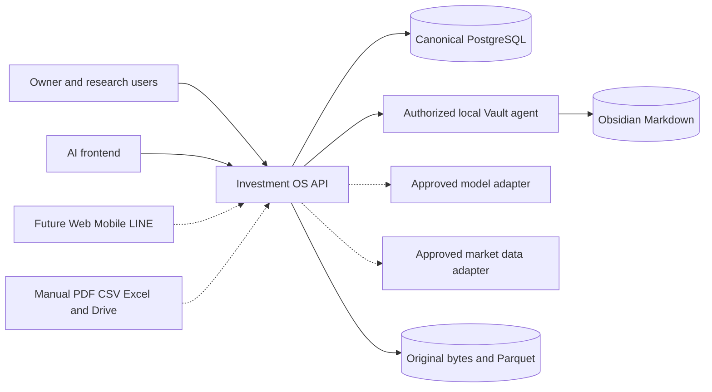

## Components and import direction

Source: [02-components.mmd](02-components.mmd)

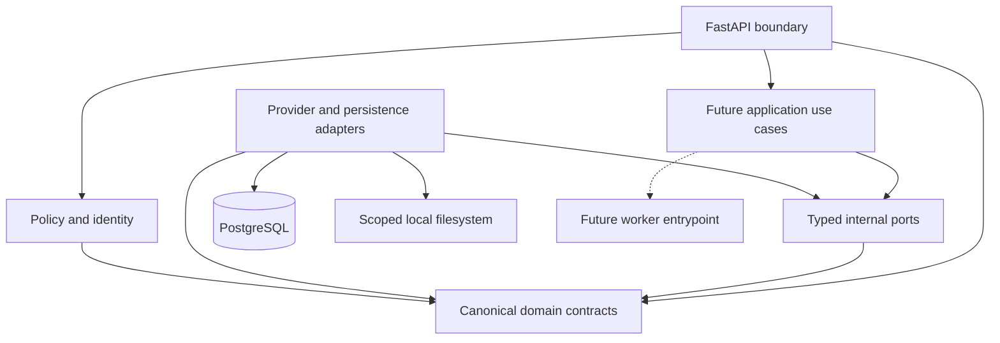

## Source data flow

Source: [03-data-flow.mmd](03-data-flow.mmd)

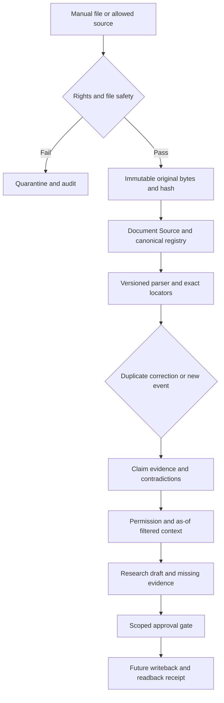

## Knowledge closed loop

Source: [04-knowledge-loop.mmd](04-knowledge-loop.mmd)

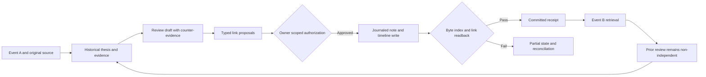

## Investment decision loop

Source: [05-decision-loop.mmd](05-decision-loop.mmd)

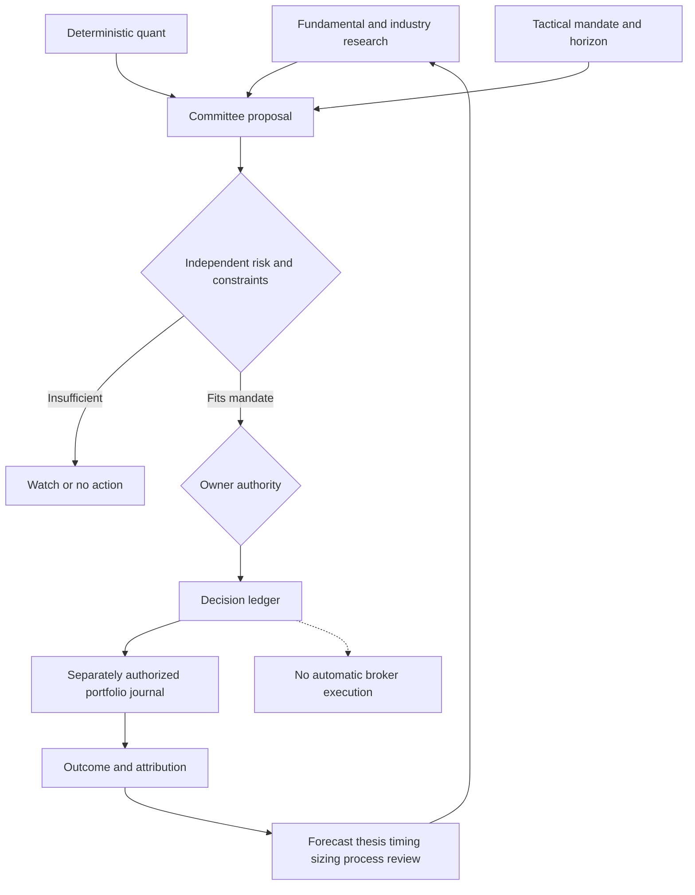

## Research orchestration

Source: [06-orchestration.mmd](06-orchestration.mmd)

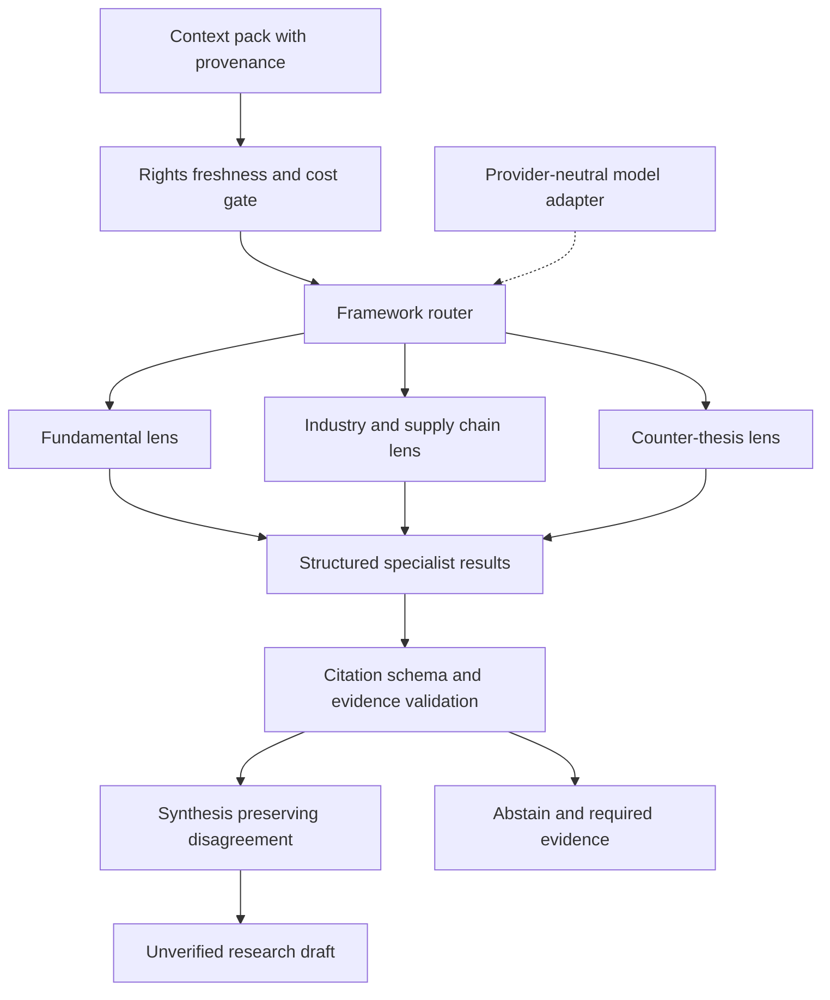

## Quant and trading separation

Source: [07-quant-tactical.mmd](07-quant-tactical.mmd)

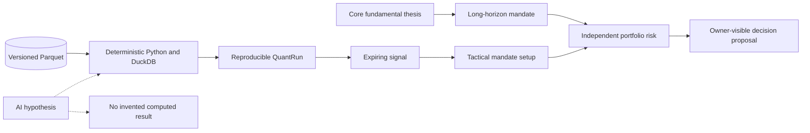

## Storage ownership

Source: [08-storage.mmd](08-storage.mmd)

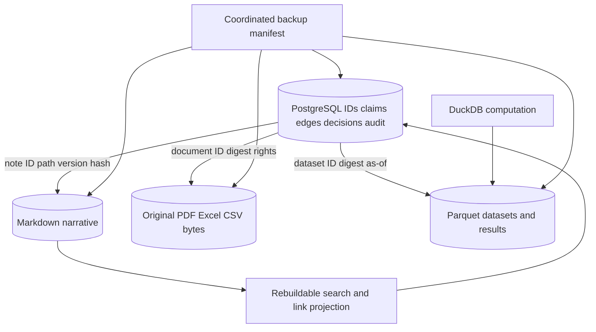

## Authorization and trust boundaries

Source: [09-trust.mmd](09-trust.mmd)

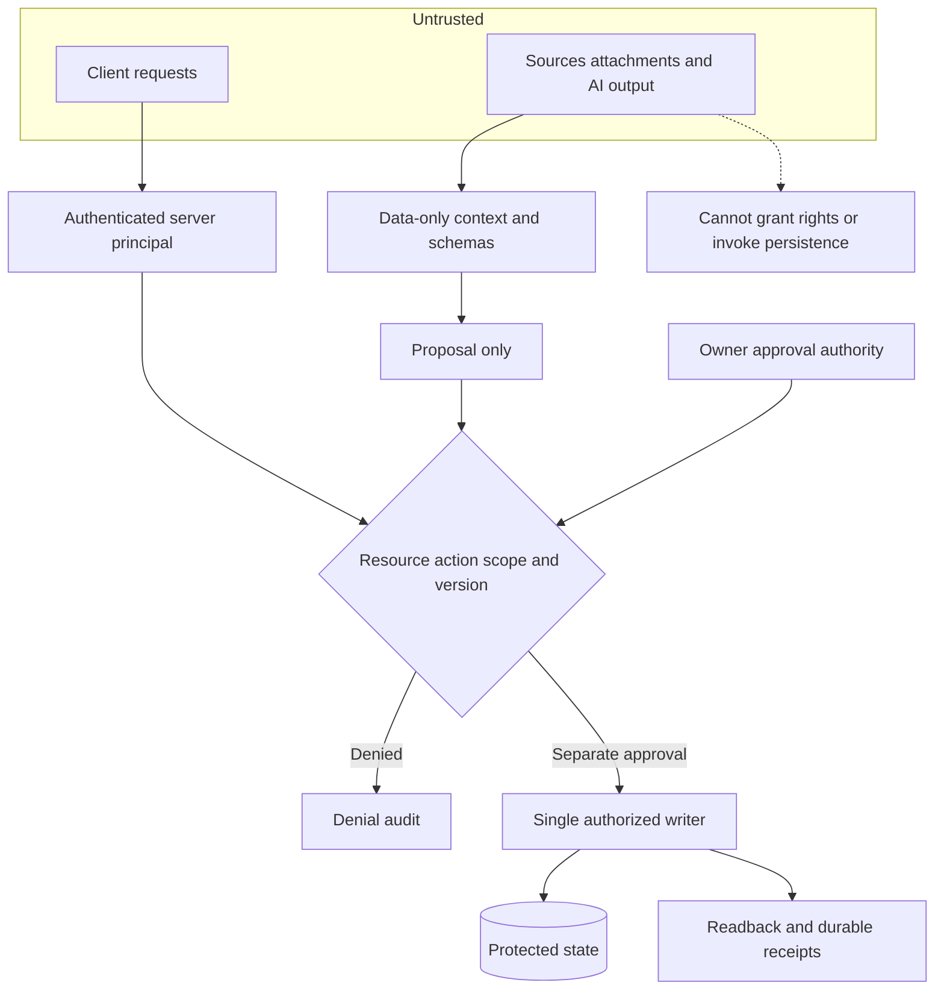

## Local-first and cloud boundary

Source: [10-local-cloud.mmd](10-local-cloud.mmd)

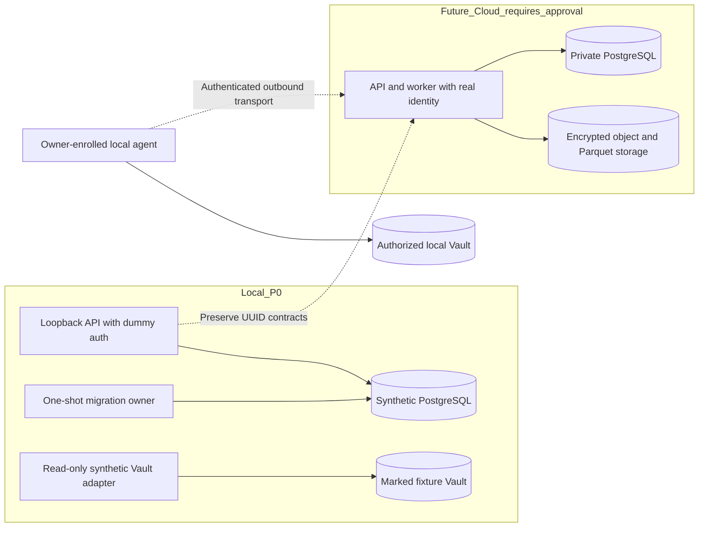

## Logical entities

Source: [11-logical-er.mmd](11-logical-er.mmd)

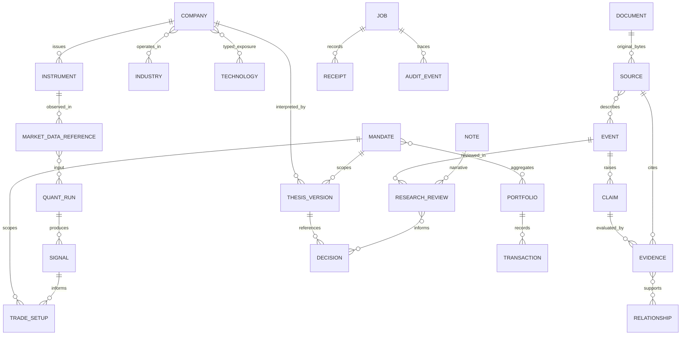

## Physical registry

Source: [12-physical-er.mmd](12-physical-er.mmd)

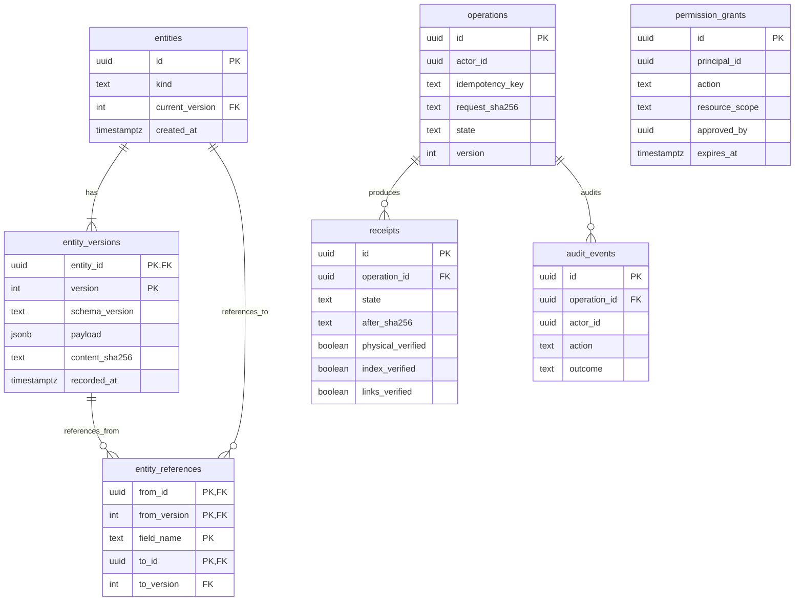
